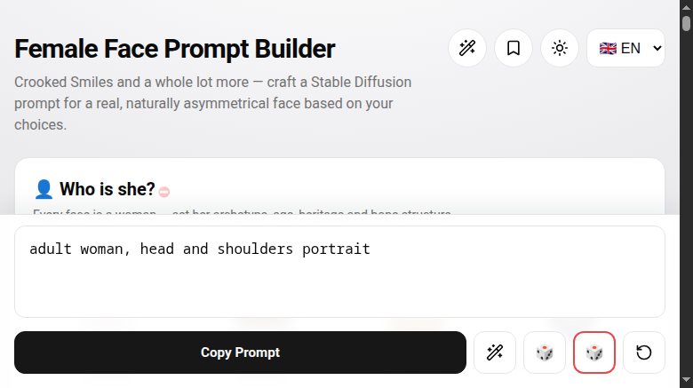

# 🎭 Crooked Smile — Face Prompt Builder

> Free, offline, **single-file** HTML app for building image-generation prompts of realistic, naturally asymmetrical female faces.

  

## What is it?

Pick options across **17 sections** — face shape, hair, eyes, cosmetics, style & vibe, lighting, camera, head pose… — and the app assembles a detailed **English prompt** for image models (Stable Diffusion, Krea 2 and modern image LLMs). **677 hand-drawn icons** make every option visible at a glance, so you can build a face the way you'd describe it to an artist.

## Quick start

1. [⬇️ Download the app (ZIP)](https://github.com/mr-kendrix/face-prompt-builder/archive/refs/heads/main.zip) and unzip it
2. Open `face_prompt_builder_offline_v2.html` (in the unzipped folder) in any modern browser — Chrome, Firefox, Safari, Edge
3. Pick options (or roll the 🎲), copy the prompt, paste it into your image tool

No server. No internet. No account. No install.

## Features

- **17 sections, 726 options, 677 hand-drawn icons** — single- and multi-select, every category can be bypassed with one click
- **🎲 Random roll** — re-roll everything, or fill only the empty slots while your picks stay pinned
- **✍️ Krea-2 optimizer** — rewrites the tag list as a natural-language scene description
- **✨ LLM prompt optimizer** — a local LLM distills your selection into a compact, non-overloaded Krea-2 scene (it drafts a short story internally, only clean prose comes out)
- **🔁 Reverse engineer** — paste your own English face prompt and the app maps it onto its own vocabulary (via a local LLM, e.g. LM Studio)
- **💾 Saved recipes** — unlimited presets, stored on your device
- **🧊 3D head-pose preview**
- **🌍 6 UI languages** (EN, DE, FR, ES, RU, ZH) — the generated prompt is always English
- **🌑 Light & dark mode**

## Requirements

- A modern web browser — that's it
- *Optional:* [LM Studio](https://lmstudio.ai) or any OpenAI-compatible local API — for the reverse-engineer mode and the LLM prompt optimizer

All faces are fictional adults (18+); the app never depicts real people.

## Status

**V2 — stable.** All 17 sections ship with full icon coverage; everything runs offline. Actively maintained — issues and PRs welcome.

## License

Free for personal, hobby and student use — **not licensed for commercial use**.

---

🇩🇪 Deutsch

**Was ist das?** Wähle in **17 Abschnitten** — Gesichtsform, Haare, Augen, Kosmetik, Stil & Ausstrahlung, Licht, Kamera, Kopfhaltung… — und die App baut daraus einen detaillierten **englischen Prompt** für Bildmodelle (Stable Diffusion, Krea 2, moderne Bild-LLMs). **677 handgezeichnete Icons** machen jede Option auf einen Blick sichtbar.

**Schnellstart**
1. [⬇️ App als ZIP herunterladen](https://github.com/mr-kendrix/face-prompt-builder/archive/refs/heads/main.zip) und entpacken
2. `face_prompt_builder_offline_v2.html` (im entpackten Ordner) in jedem modernen Browser öffnen — Chrome, Firefox, Safari, Edge
3. Optionen wählen (oder 🎲 würfeln), Prompt kopieren, ins Bildtool einfügen

Kein Server. Kein Internet. Kein Konto. Keine Installation.

**Features**
- **17 Abschnitte, 726 Optionen, 677 handgezeichnete Icons** — Einzel- und Mehrfachauswahl, jede Kategorie lässt sich mit einem Klick überspringen
- **🎲 Zufalls-Würfel** — alles neu würfeln, oder nur die leeren Slots füllen (deine Auswahl bleibt fixiert)
- **✍️ Krea-2-Optimierer** — schreibt die Tag-Liste als Szenenbeschreibung in natürlicher Sprache um
- **✨ LLM-Prompt-Optimierer** — ein lokales LLM destilliert deine Auswahl zu einer kompakten, nicht überladenen Krea-2-Szene (intern wird eine kurze Geschichte entworfen, heraus kommt nur sauberer Fließtext)
- **🔁 Reverse Engineer** — eigenen englischen Prompt einfügen, die App mappt ihn auf ihren eigenen Wortschatz (per lokalem LLM, z. B. LM Studio)
- **💾 Gespeicherte Rezepte** — unbegrenzt viele Presets, gespeichert auf deinem Gerät
- **🧊 3D-Preview der Kopfhaltung**
- **🌍 6 UI-Sprachen** (EN, DE, FR, ES, RU, ZH) — der generierte Prompt ist immer Englisch
- **🌑 Light- & Darkmode**

**Voraussetzungen**: Ein moderner Browser — das ist alles. *Optional:* [LM Studio](https://lmstudio.ai) oder jede OpenAI-kompatible lokale API — für den Reverse-Engineering-Modus und den LLM-Prompt-Optimierer.
Alle Gesichter sind fiktive Erwachsene (18+); die App stellt nie echte Personen dar.

**Status**: **V2 — stabil.** Alle 17 Abschnitte mit voller Icon-Abdeckung, läuft komplett offline. Aktive Weiterentwicklung — Issues und PRs willkommen.

**Lizenz**: Kostenlos für private, Hobby- und Studienzwecke — **keine kommerzielle Lizenz**.

🇫🇷 Français

**C'est quoi ?** Choisissez des options dans **17 sections** — forme du visage, cheveux, yeux, maquillage, style, éclairage, caméra, pose de la tête… — et l'application compose un **prompt anglais** détaillé pour les modèles d'image (Stable Diffusion, Krea 2, LLM d'image modernes). **677 icônes dessinées à la main** rendent chaque option visible d'un coup d'œil.

**Démarrage rapide**
1. [⬇️ Télécharger l'application (ZIP)](https://github.com/mr-kendrix/face-prompt-builder/archive/refs/heads/main.zip) et l'extraire
2. Ouvrir `face_prompt_builder_offline_v2.html` (dans le dossier extrait) dans n'importe quel navigateur moderne — Chrome, Firefox, Safari, Edge
3. Choisir des options (ou lancer le 🎲), copier le prompt, le coller dans votre outil d'image

Aucun serveur. Aucun internet. Aucun compte. Aucune installation.

**Fonctionnalités**
- **17 sections, 726 options, 677 icônes dessinées à la main** — sélection simple et multiple, chaque catégorie se passe d'un clic
- **🎲 Lancer aléatoire** — tout relancer, ou ne remplir que les cases vides (vos choix restent fixés)
- **✍️ Optimiseur Krea-2** — réécrit la liste de tags en description de scène en langage naturel
- **✨ Optimiseur de prompt par LLM** — un LLM local distille votre sélection en une scène Krea-2 compacte, sans surcharge (une courte histoire est rédigée en interne, seul un texte propre est renvoyé)
- **🔁 Rétro-ingénierie** — collez votre propre prompt anglais, l'application le mappe sur son propre vocabulaire (via un LLM local, ex. LM Studio)
- **💾 Recettes enregistrées** — presets illimités, stockés sur votre appareil
- **🧊 Aperçu 3D de la pose de la tête**
- **🌍 6 langues d'interface** (EN, DE, FR, ES, RU, ZH) — le prompt généré est toujours en anglais
- **🌑 Mode clair & sombre**

**Prérequis** : un navigateur web moderne — c'est tout. *Optionnel :* [LM Studio](https://lmstudio.ai) ou toute API locale compatible OpenAI — pour le mode rétro-ingénierie et l'optimiseur de prompt par LLM.
Tous les visages sont des adultes fictifs (18+) ; l'application ne représente jamais de vraies personnes.

**Statut** : **V2 — stable.** Les 17 sections avec couverture icônes complète, 100 % hors ligne. Maintenance active — issues et PR bienvenues.

**Licence** : Gratuit pour un usage personnel, loisir et étudiant — **pas de licence commerciale**.

🇪🇸 Español

**¿Qué es?** Elige opciones en **17 secciones** — forma del rostro, pelo, ojos, maquillaje, estilo, iluminación, cámara, pose de la cabeza… — y la aplicación compone un **prompt en inglés** detallado para modelos de imagen (Stable Diffusion, Krea 2, LLM de imagen modernos). **677 iconos dibujados a mano** hacen que cada opción sea visible de un vistazo.

**Inicio rápido**
1. [⬇️ Descarga la aplicación (ZIP)](https://github.com/mr-kendrix/face-prompt-builder/archive/refs/heads/main.zip) y descomprímela
2. Abre `face_prompt_builder_offline_v2.html` (en la carpeta descomprimida) en cualquier navegador moderno — Chrome, Firefox, Safari, Edge
3. Elige opciones (o lanza el 🎲), copia el prompt y pégalo en tu herramienta de imagen

Sin servidor. Sin internet. Sin cuenta. Sin instalación.

**Características**
- **17 secciones, 726 opciones, 677 iconos dibujados a mano** — selección simple y múltiple, cada categoría se puede omitir con un clic
- **🎲 Sorteo aleatorio** — relanzar todo, o rellenar solo las casillas vacías (tus elecciones quedan fijas)
- **✍️ Optimizador Krea-2** — reescribe la lista de etiquetas como descripción de escena en lenguaje natural
- **✨ Optimizador de prompts por LLM** — un LLM local destila tu selección en una escena Krea-2 compacta, sin sobrecargar (redacta una historia corta en interno, solo sale prosa limpia)
- **🔁 Ingeniería inversa** — pega tu propio prompt en inglés y la aplicación lo mapea a su propio vocabulario (vía LLM local, p. ej. LM Studio)
- **💾 Recetas guardadas** — presets ilimitados, almacenados en tu dispositivo
- **🧊 Vista previa 3D de la pose de la cabeza**
- **🌍 6 idiomas de interfaz** (EN, DE, FR, ES, RU, ZH) — el prompt generado siempre es en inglés
- **🌑 Modo claro y oscuro**

**Requisitos**: un navegador web moderno — eso es todo. *Opcional:* [LM Studio](https://lmstudio.ai) o cualquier API local compatible con OpenAI — para el modo de ingeniería inversa y el optimizador de prompts por LLM.
Todos los rostros son adultos ficticios (18+); la aplicación nunca representa personas reales.

**Estado**: **V2 — estable.** Las 17 secciones con cobertura completa de iconos; todo funciona sin conexión. Mantenimiento activo — issues y PR bienvenidos.

**Licencia**: Gratis para uso personal, aficionado y estudiantil — **sin licencia comercial**.

🇷🇺 Русский

**Что это?** Выбирайте опции в **17 разделах** — форма лица, волосы, глаза, макияж, стиль, свет, камера, поза головы… — и приложение собирает из этого подробный **английский промпт** для моделей генерации изображений (Stable Diffusion, Krea 2, современные image-LLM). **677 рисованных иконок** делают каждый вариант понятным с первого взгляда.

**Быстрый старт**
1. [⬇️ Скачайте приложение (ZIP)](https://github.com/mr-kendrix/face-prompt-builder/archive/refs/heads/main.zip) и распакуйте его
2. Откройте `face_prompt_builder_offline_v2.html` (из распакованной папки) в любом современном браузере — Chrome, Firefox, Safari, Edge
3. Выберите опции (или бросьте 🎲), скопируйте промпт и вставьте в ваш инструмент генерации

Без сервера. Без интернета. Без аккаунта. Без установки.

**Возможности**
- **17 разделов, 726 опций, 677 рисованных иконок** — одиночный и множественный выбор, любой раздел можно пропустить одним кликом
- **🎲 Случайный ролл** — перебросить всё, или заполнить только пустые слоты (ваши выборы остаются закреплёнными)
- **✍️ Оптимизатор Krea-2** — переписывает список тегов в описание сцены естественным языком
- **✨ LLM-оптимизатор промпта** — локальная LLM сжимает ваш выбор в компактную, не перегруженную сцену Krea-2 (внутри черновик короткой истории, наружу — только чистый текст)
- **🔁 Обратная инженерия** — вставьте свой английский промпт, приложение отобразит его на собственном словаре (через локальную LLM, например LM Studio)
- **💾 Сохранённые рецепты** — неограниченное число пресетов, хранятся на вашем устройстве
- **🧊 3D-превью позы головы**
- **🌍 6 языков интерфейса** (EN, DE, FR, ES, RU, ZH) — генерируемый промпт всегда на английском
- **🌑 Светлая и тёмная темы**

**Требования**: современный браузер — и всё. *Необязательно:* [LM Studio](https://lmstudio.ai) или любой локальный API, совместимый с OpenAI — для режима обратной инженерии и LLM-оптимизатора промпта.
Все лица — вымышленные взрослые (18+); приложение никогда не изображает реальных людей.

**Статус**: **V2 — стабильная.** Все 17 разделов с полным покрытием иконок; всё работает офлайн. Активная разработка — issues и PR приветствуются.

**Лицензия**: Бесплатно для личного, хобби и студенческого использования — **без коммерческой лицензии**.

🇨🇳 中文

**这是什么？** 在 **17 个分区** 中挑选选项——脸型、发型、眼睛、妆容、风格气质、光线、镜头、头部姿态……——应用会为你生成一条详细的**英文提示词**，适用于图像模型（Stable Diffusion、Krea 2 及现代图像 LLM）。**677 个手绘图标**让每个选项一目了然。

**快速上手**
1. [⬇️ 下载应用（ZIP）](https://github.com/mr-kendrix/face-prompt-builder/archive/refs/heads/main.zip) 并解压
2. 用任意现代浏览器打开解压后文件夹中的 `face_prompt_builder_offline_v2.html`——Chrome、Firefox、Safari、Edge
3. 选择选项（或掷骰子 🎲），复制提示词，粘贴到你的图像工具中

无需服务器。无需联网。无需账号。无需安装。

**功能**
- **17 个分区、726 个选项、677 个手绘图标**——单选/多选，每个分区都可一键跳过
- **🎲 随机生成**——全部重掷，或只填充空选项（已选内容保持不变）
- **✍️ Krea-2 优化器**——将标签列表改写为自然语言的场景描述
- **✨ LLM 提示词优化器**——本地 LLM 将你的选择浓缩为紧凑、不冗长的 Krea-2 场景（内部生成简短故事，输出只有干净的文字）
- **🔁 反向解析**——粘贴你自己的英文提示词，应用会将其映射到自己的词库（通过本地 LLM，如 LM Studio）
- **💾 已保存配方**——无限量预设，存储在你的设备上
- **🧊 头部姿态 3D 预览**
- **🌍 6 种界面语言**（EN、DE、FR、ES、RU、ZH）——生成的提示词始终为英文
- **🌑 浅色 / 深色模式**

**要求**：一个现代浏览器——就这些。*可选*：[LM Studio](https://lmstudio.ai) 或任何 OpenAI 兼容的本地 API——用于反向解析模式和 LLM 提示词优化器。
所有面孔均为虚构成人（18+）；本应用绝不描绘真实人物。

**状态**：**V2 — 稳定版。** 17 个分区全部配备图标，完全离线运行。持续维护中——欢迎提交 issue 和 PR。

**许可**：免费用于个人、爱好和学习用途——**不授权商业用途**。

